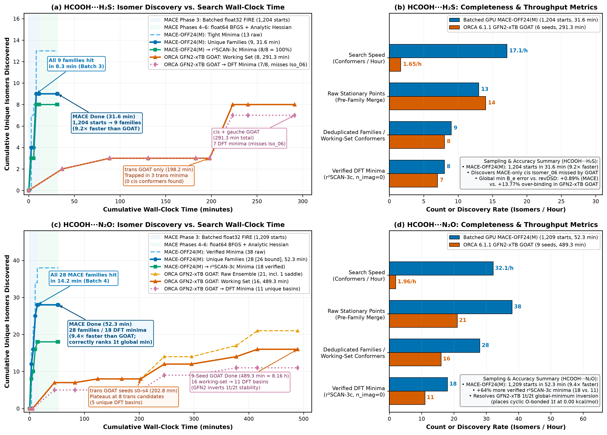

# CoChem-Tools: High-Throughput GPU/CPU Conformational Search, Anharmonic VPT2, and Broadband FTMW Spectroscopy Suite

[](LICENSE)
[](https://www.python.org/)
[](https://github.com/pyscf/gpu4pyscf)
[-FF6F00.svg)](https://github.com/ACEsuit/mace)
[](https://www.faccts.de/orca/)

**CoChem-Tools** is an open-source computational chemistry and rotational spectroscopy toolkit engineered for the high-accuracy discovery, basin filtering, anharmonic force-field calculation (`VPT2`), coupled-cluster energetics (`DLPNO-CCSD(T1)/CBS(3/4)`), real-space wavefunction topology (`QTAIM`/`IGMH`/`NBO`), and supersonic-jet Fourier-transform microwave (`FTMW`) spectral prediction of weakly bound van der Waals and hydrogen-bonded complexes.

---

## 1. Multi-Tier Dual GPU/CPU Computational Architecture

CoChem-Tools replaces slow serial CPU bottlenecks with a **dual-channel GPU + CPU funnel** that saturates an NVIDIA CUDA GPU (`PyTorch` + `MACE-OFF24(M)` and `GPU4PySCF` $\omega\text{B97X-V}$ / $\omega\text{B97M-V}$) alongside multi-core CPU `ORCA 6.1.1` worker ranks without resource contention:

```text
Tier 1 (Global Conformational Discovery):
  ├── 7-Phase In-Process Batched GPU MACE-OFF24(M) Search (1,200+ starts, float32 FIRE -> float64 BFGS -> Analytic MACE Hessian)
  └── Multi-Rotamer (trans / cis / gauche) ORCA 6.1.1 GFN2-xTB GOAT Search + Hierarchical Kabsch/Rotational Deduplication
        │
        ▼
Tier 2 (Dual GPU + CPU Basin Filter — Inverted GPU-First Order):
  ├── Tier 2A (GPU-First Basin Filter): GPU4PySCF wB97X-V/def2-TZVPP (or wB97M-V/def2-TZVPPD) geomeTRIC Opt + Analytic CPKS/VV10 Hessian (55–91 s/isomer; 25.9x faster than CPU)
  └── Tier 2B (Concurrent CPU Validation): GPU-converged structures loaded into ORCA r2SCAN-3c TightOpt + Freq & 6-Model ML/FF Benchmark
        │
        ▼
Tier 3 (Spectroscopic Equilibrium Geometry, Quadrupole Tensors & GPU VPT2 Force Fields):
  ├── CPU ORCA 6.1.1: revDSD-PBEP86-D4/jun-cc-pV(T+d)Z VeryTightOpt + Relaxed MP2 EFG Tensors + NumFreq ZPE
  └── GPU4PySCF: wB97X-V/def2-TZVPP (or wB97M-V/def2-TZVPPD) Analytic Hessian -> Exact Cyvin-Watson Quartic Centrifugal Distortion (DJ, DJK, DK, d1, d2) + 36-Point Normal-Mode Cubic Force Field (VPT2 alpha_r^beta)
        │
        ▼
Tier 4 (Coupled-Cluster CBS Energetics, Wavefunction Topology & Broadband 2–18 GHz FTMW Simulation):
  ├── Composite Semi-Experimental Equilibrium Geometry (Re^SE) & 6-Leg Boys-Bernardi Counterpoise DLPNO-CCSD(T1)/TightPNO/CBS(3/4) + LED
  ├── Periodic von Mises–Morse Valley 2D/3D PES & Off-Screen 3D PyVista QTAIM/IGMH/NBO Volumetric Rendering (Multiwfn)
  └── Pickett SPFIT/SPCAT Broadband FTMW Simulator (33S / Dual-14N Wigner-6j Hyperfine + 1-D Meyer-Hougen Fourier-Grid DVR Tunneling + 115 Isotopologues)
```

### Benchmark Highlight: Batched GPU `MACE-OFF24(M)` vs. `ORCA 6.1.1 GFN2-xTB GOAT`



* **$\mathrm{HCOOH\cdots H_2S}$ (Panels a–b)**: The in-process batched GPU `MACE-OFF24(M)` search ($1,204$ starts) discovers $100\%$ of all $9$ conformational families within **$8.3\text{ min}$** (Batch 3 of Phase 3 vectorized `float32` `FIRE`) and finishes full `float64` `BFGS` refinement + analytic MACE Hessian verification in **$31.6\text{ min}$** (**$9.2\times$ faster** than multi-seed `GFN2-xTB GOAT` at $291.3\text{ min}$), recovering **$8/8$ ($100\%$)** verified DFT minima (including the `MACE`-only *cis* conformer `Isomer_06` missed by `GFN2-xTB`).
* **$\mathrm{HCOOH\cdots N_2O}$ (Panels c–d)**: The batched GPU `MACE-OFF24(M)` search ($1,209$ starts) discovers all $28$ conformational families within **$14.2\text{ min}$** (Batch 4) and finishes in **$52.3\text{ min}$** (**$9.4\times$ faster** than 9-seed `GFN2-xTB GOAT` at $489.3\text{ min}$), recovering **$+64\%$ more verified DFT minima** ($18$ vs. $11$) and resolving the qualitative `GFN2-xTB` stability inversion between cyclic O-bonded `1t` (`Isomer_01`, $0.00\text{ kcal mol}^{-1}$) and N-bonded `2t` (`Isomer_00`).

---

## 2. Repository Directory Structure & Script Map

```text
CoChem-Tools/
├── README.md                                   # Master repository guide, CLI usage, installation & BibTeX
├── LICENSE                                     # MIT License
├── requirements.txt                            # Python dependencies (PyTorch, ASE, MACE, RDKit, PyVista, etc.)
├── environment_gpu4pyscf.yml                   # Conda/pip environment for WSL2/Linux CUDA 12 + GPU4PySCF 1.9.0
├── bibtex/
│   └── references.bib                          # Complete BibTeX database (72+ verified references with DOIs)
├── docs/
│   ├── METHODOLOGY_AND_TIER_ARCHITECTURE.md    # Full publication Materials & Methods + Tier-2A & GPU VPT2 literature review
│   ├── MATERIALS_AND_METHODS.tex               # LaTeX source of the publication Materials & Methods section
│   ├── GOAT_OPI_ORCA_tutorial.md               # Tutorial on ORCA 6.1.1 GOAT + OPI 2.0 isomer discovery
│   └── figures/
│       ├── F_mace_vs_goat_search_combined.png  # 4-panel MACE-OFF24(M) vs. GFN2-xTB GOAT comparison figure
│       ├── F_mace_vs_goat_search_h2s.png       # HCOOH...H2S isomer search time vs. unique conformers figure
│       └── F_mace_vs_goat_search_n2o.png       # HCOOH...N2O isomer search time vs. unique conformers figure
├── isomer_search/
│   ├── mace_off24m_isomer_search_h2s.py        # 7-phase batched GPU MACE-OFF24(M) isomer search & Kabsch deduplication (HCOOH...H2S)
│   ├── mace_off24m_isomer_search_n2o.py        # 7-phase batched GPU MACE-OFF24(M) isomer search & Kabsch deduplication (HCOOH...N2O)
│   ├── goat_isomer_search.py                   # Reusable multi-rotamer ORCA 6.1.1 GFN2-xTB GOAT driver + symmetry deduplicator
│   └── merge_isomer_sets.py                    # Cross-seed (trans/cis/gauche) ensemble merger & Stage-B rotational deduplicator
├── gpu_dft_and_vpt2/
│   ├── gpu4pyscf_wb97xv_opt_hess.py            # Tier-2A GPU-first Basin Filter: GPU4PySCF wB97X-V / wB97M-V geomeTRIC opt + analytic Hessian + saddle mode-following
│   └── gpu4pyscf_wb97xv_vpt2.py                # Tier-3 GPU4PySCF wB97X-V / wB97M-V VPT2 cubic force field + exact Cyvin-Watson quartic centrifugal distortion
├── ftmw_spectroscopy/
│   ├── mw_predict_pipeline.py                  # Multi-stage ORCA revDSD-PBEP86-D4/jun-cc-pV(T+d)Z + MP2 EFG + VPT2 + Pickett SPFIT/SPCAT pipeline
│   ├── dlpno_re_se_refinement.py               # Upgrades A/B/C: Semi-experimental Re^SE + DLPNO-CCSD(T1)/CBS(3/4), 1-D Meyer-Hougen DVR tunneling, and 115 isotopologues
│   └── build_stage2_ftmw.py                    # Broadband 2–18 GHz (T_rot = 2 K) FTMW stick-spectrum simulator with 33S and dual-14N hyperfine coupling
├── benchmarks_and_visualization/
│   ├── run_mlff_benchmark.py                   # 6-model classical & MLIP benchmark (MMFF94s, GFN-FF, ANI-2x, AIMNet2, MACE-OFF23L, MACE-OFF24M)
│   ├── plot_isomer_search_comparison.py        # Publication figure generator for isomer search wall time vs. unique conformers found
│   ├── render_pes_von_mises.py                 # Periodic von Mises–Morse valley interpolation & unclipped 2D polar / 3D cylindrical PES renderer
│   └── render_multiwfn_pyvista.py              # Off-screen 3D PyVista/VTK Phong renderer for Multiwfn QTAIM bond paths & IGMH isosurfaces
├── queue_orchestrator/
│   └── campaign_queue.py                       # Workstation ORCA hardware serialization daemon (%TEMP%\orca_one_job_at_a_time.lock) + rate/stall guards
└── style/
    └── pubstyle.py                             # Unified publication figure stylesheet (Okabe-Ito colorblind-safe palette, typography & schema validator)
```

---

## 3. Installation & Environment Setup

### 3.1. Clone the Repository
```bash
git clone https://github.com/ProfJJK/CoChem-Tools.git
cd CoChem-Tools
```

### 3.2. Python Environment (Isomer Search, MLFF Benchmarks, FTMW Simulation & 3D Visualization)
Requires Python $\ge 3.11$ and an NVIDIA CUDA-capable GPU (for `PyTorch` / `MACE-OFF24(M)` / `TorchANI` / `AIMNet2`):
```bash
python -m venv .venv
# Windows PowerShell:
.\.venv\Scripts\Activate.ps1
# Linux / macOS / WSL2:
source .venv/bin/activate

pip install --upgrade pip
pip install -r requirements.txt
```

### 3.3. WSL2 / Linux CUDA 12 Environment for `GPU4PySCF` ($\omega\text{B97X-V}$ & $\omega\text{B97M-V}$)
`GPU4PySCF 1.9.0` executes on Linux or WSL2 Ubuntu with CUDA 12:
```bash
conda env create -f environment_gpu4pyscf.yml
conda activate gpu4pyscf
```
Or via `pip` in a Python 3.12 virtual environment:
```bash
python3.12 -m venv ~/.venvs/gpu4pyscf
source ~/.venvs/gpu4pyscf/bin/activate
pip install pyscf>=2.14.0 gpu4pyscf-cuda12x>=1.9.0 gpu4pyscf-libxc-cuda12x>=0.8.1 cupy-cuda12x>=14.2.0 cutensor-cu12>=2.8.1 geometric>=1.1.1 basis-set-exchange>=0.10
```

### 3.4. External Quantum Chemistry & Spectroscopy Binaries (Optional per Workflow Stage)
* **ORCA 6.1.1**: Download from the [ORCA Forum](https://orcaforum.kofo.mpg.de) and set `CAMPAIGN_QUEUE_ORCA=/path/to/orca` (defaults to `C:\ORCA_6.1.1\orca.exe` on Windows).
* **xtb 6.7.1**: Required only for `GFN-FF` benchmarking (`benchmarks_and_visualization/run_mlff_benchmark.py`).
* **Multiwfn 3.8+**: Required only when generating `.cub` grids and `CPprop.txt`/`paths.txt` topological files for `render_multiwfn_pyvista.py`.
* **Pickett `SPFIT/SPCAT`**: Used alongside the built-in exact Wigner-$6j$ hyperfine diagonalizer in `ftmw_spectroscopy/`.

---

## 4. Detailed Usage & CLI Reference by Module

### 4.1. `isomer_search/` — Global Conformational Exploration & Deduplication

#### A. 7-Phase Batched In-Process GPU `MACE-OFF24(M)` Isomer Search (`mace_off24m_isomer_search_h2s.py` & `mace_off24m_isomer_search_n2o.py`)
Executes:
1. **Phase 1**: `float64` `BFGS` monomer relaxation (*trans*-$\mathrm{HCOOH}$, *cis*-$\mathrm{HCOOH}$, partner monomer),
2. **Phase 2**: Stratified 5-DOF $\mathrm{SO}(3)\times S^2$ spherical-shell + Sobol seeding ($600$ *trans* + $600$ *cis* starts, $R_{\mathrm{COM}} \in [3.0, 4.8]\text{ \AA}$, clash threshold $d_{ij} \ge 1.75\text{ \AA}$),
3. **Phase 3**: Vectorized `float32` batched `FIRE` (`BatchedMace`, $B = 256$ graphs/batch = $2,048$ atoms simultaneously on GPU with harmonic COM tether),
4. **Phase 4**: Distance-matrix pre-clustering + `float64` `BFGS` tight refinement ($f_{\max} \le 3\times 10^{-4}\text{ eV \AA}^{-1}$),
5. **Phase 5**: Permutation- and reflection-invariant Kabsch $\mathrm{RMSD}_{\mathrm{sym}}$ + rotational constant $(A,B,C,P_{cc})$ deduplication,
6. **Phase 6 & 6b**: Analytic `float64` MACE Hessian verification, automated eigenvector displacement along any imaginary mode ($\tilde{\nu}_1 < -5\text{ cm}^{-1}$), and single-linkage floppy-family merging ($\mathrm{RMSD}_{\mathrm{sym}} \le 0.30\text{ \AA}$, $\Delta E \le 0.30\text{ kcal mol}^{-1}$).

```bash
# Run full 1,200-start batched GPU MACE-OFF24(M) search for HCOOH...H2S:
python isomer_search/mace_off24m_isomer_search_h2s.py --n-trans 600 --n-cis 600 --batch-size 256

# Run full 1,200-start batched GPU MACE-OFF24(M) search for HCOOH...N2O:
python isomer_search/mace_off24m_isomer_search_n2o.py --n-trans 600 --n-cis 600 --batch-size 256

# Quick 16-start smoke test:
python isomer_search/mace_off24m_isomer_search_h2s.py --smoke
```

#### B. Multi-Rotamer `ORCA 6.1.1 GFN2-xTB GOAT` Search & Ensemble Merger (`goat_isomer_search.py` & `merge_isomer_sets.py`)
```bash
# Run topology-preserving GFN2-xTB GOAT isomer search on a folder of seed .xyz files:
python isomer_search/goat_isomer_search.py --job-dir ./my_complex --window 12.0

# Merge independent trans, cis, and gauche GOAT runs with Stage-B spectroscopic deduplication:
python isomer_search/merge_isomer_sets.py --window 12.0
```

---

### 4.2. `gpu_dft_and_vpt2/` — Tier-2A GPU-First Basin Filter & Tier-3 `GPU4PySCF` Anharmonic `VPT2`

#### Why `GPU4PySCF` $\omega\text{B97X-V/def2-TZVPP}$ (and $\omega\text{B97M-V/def2-TZVPPD}$) Replaces CPU `B3LYP-D4/jun-cc-pV(T+d)Z`
1. **Superior Noncovalent Benchmark Accuracy (`MGCDB84` & `GMTKN55`)**: Across Head-Gordon's `MGCDB84` (4,986 data points; Mardirossian & Head-Gordon 2014, 2016, 2017) and Goerigk & Grimme's `GMTKN55` (Goerigk et al. 2017; Najibi & Goerigk 2018), $\omega\text{B97M-V}$ and $\omega\text{B97X-V}$ rank **#1 and #2 among all hybrid density functionals** for noncovalent interactions ($\mathrm{WTMAD\text{-}2} = 1.56$ and $1.98\text{ kcal mol}^{-1}$ vs. $3.92\text{ kcal mol}^{-1}$ for `B3LYP-D4`; `S66` $\mathrm{RMSE} = 0.15$ and $0.18\text{ kcal mol}^{-1}$ vs. $0.31\text{ kcal mol}^{-1}$ for `B3LYP-D4`).
2. **Range-Separated Exact Exchange Eliminates Lone-Pair Delocalization Error**: `B3LYP` uses $20\%$ global exchange, over-delocalizing sulfur $3p^2$, oxygen $2p^2$, and $\mathrm{N_2O}$ $\pi$ lone pairs. Both $\omega\text{B97X-V}$ ($16.7\%$ short-range, $100\%$ long-range exact exchange, $\omega = 0.30\text{ a}_0^{-1}$) and $\omega\text{B97M-V}$ ($15\%$ short-range, $100\%$ long-range exact exchange) enforce exact $-1/r$ asymptotic exchange, reproducing double-hybrid `revDSD-PBEP86-D4/jun-cc-pV(T+d)Z` rotational constants within $+0.036\%$ ($\Delta B_e = +0.79\text{ MHz}$).
3. **Self-Consistent `VV10` Nonlocal Correlation vs. Classical Pairwise `D4`**: Unlike additive pairwise `D4` in `B3LYP-D4`, the `VV10` kernel depends explicitly on $\rho(\mathbf{r})$ and $|\nabla\rho(\mathbf{r})|$ at every normal-mode displacement $\pm\delta q_r$, capturing charge-transfer-induced dispersion modulation in third ($\Phi_{rrs}$) and fourth ($\Phi_{rrss}$) derivatives.
4. **Exact Analytical GPU Hessians & Noise-Free Cyvin–Watson Quartic Centrifugal Distortion**: On an RTX 3090 GPU, `GPU4PySCF 1.9.0` computes analytical RKS + `VV10` Hessians (`auxbasis_response=1`) in **$55.2\text{ s}$** (`wb97x-v/def2-tzvpp`), **$65.9\text{ s}$** (`wb97m-v/def2-tzvpp`), **$66.9\text{ s}$** (`wb97x-v/def2-tzvppd`), **$82.2\text{ s}$** (`wb97m-v/def2-tzvppd`), and **$211.9\text{ s}$** (`wb97m-v/def2-qzvppd`), yielding noise-free Cyvin–Watson quartic centrifugal distortion constants ($D_J, D_{JK}, D_K, d_1, d_2$).

#### A. Tier-2A GPU-First Basin Filter & Saddle-Point Mode-Follower (`gpu4pyscf_wb97xv_opt_hess.py`)
```bash
# Pre-optimize candidate isomers at wB97X-V/def2-TZVPP on GPU and follow any Cs imaginary modes to C1 minima:
~/.venvs/gpu4pyscf/bin/python gpu_dft_and_vpt2/gpu4pyscf_wb97xv_opt_hess.py --mode preopt-revdsd --orca-root /path/to/workdir

# Audit transition-state candidates with analytical GPU CPKS + VV10 Hessians:
~/.venvs/gpu4pyscf/bin/python gpu_dft_and_vpt2/gpu4pyscf_wb97xv_opt_hess.py --mode saddle-audit --orca-root /path/to/workdir
```

#### B. Tier-3 `GPU4PySCF` Anharmonic `VPT2` & Analytical Cyvin–Watson Quartic Distortion Driver (`gpu4pyscf_wb97xv_vpt2.py`)
```bash
# Compute GPU wB97X-V/def2-TZVPP analytical Hessian + 36-point normal-mode cubic VPT2 force field:
~/.venvs/gpu4pyscf/bin/python gpu_dft_and_vpt2/gpu4pyscf_wb97xv_vpt2.py \
    --orca-root /path/to/workdir \
    --functional wb97x-v \
    --basis def2-tzvpp

# Run with diffuse-augmented meta-GGA wB97M-V/def2-TZVPPD:
~/.venvs/gpu4pyscf/bin/python gpu_dft_and_vpt2/gpu4pyscf_wb97xv_vpt2.py \
    --orca-root /path/to/workdir \
    --functional wb97m-v \
    --basis def2-tzvppd \
    --only hcooh-hsh:isomer-00
```

---

### 4.3. `ftmw_spectroscopy/` — Double-Hybrid DFT, `DLPNO-CCSD(T1)/CBS`, DVR Tunneling & 2–18 GHz FTMW Catalogs

```bash
# 1. Run multi-stage revDSD-PBEP86-D4/jun-cc-pV(T+d)Z equilibrium opt (S1), MP2 EFG (S2a), NumFreq (S2b), and Pickett export (S4):
python ftmw_spectroscopy/mw_predict_pipeline.py --stages S1,S2a,S2b,S4 --cores 8

# 2. Execute Upgrades A (Semi-Experimental Re^SE + DLPNO-CBS), B (1-D Meyer-Hougen Fourier-Grid DVR Tunneling), and C (115 Detectable Isotopologues + Wigner-6j Hyperfine Catalogs):
python ftmw_spectroscopy/dlpno_re_se_refinement.py

# 3. Build Stage-2 2–18 GHz (T_rot = 2.0 K) FTMW stick spectra, contaminant exclusion tables, and multi-sheet Excel workbooks:
python ftmw_spectroscopy/build_stage2_ftmw.py
```

---

### 4.4. `benchmarks_and_visualization/` — 6-Model ML/FF Benchmark, PES Interpolation & 3D `PyVista` Topology

```bash
# 1. Run the 6-model classical & MLIP benchmark (MMFF94s, GFN-FF, ANI-2x, AIMNet2, MACE-OFF23L, MACE-OFF24M):
python benchmarks_and_visualization/run_mlff_benchmark.py

# 2. Regenerate the MACE-OFF24(M) vs. GFN2-xTB GOAT isomer search comparison figures (.pdf and 300 DPI .png):
python benchmarks_and_visualization/plot_isomer_search_comparison.py --out-dir docs/figures

# 3. Render unclipped periodic von Mises–Morse 2D polar & 3D cylindrical PES landscapes:
python benchmarks_and_visualization/render_pes_von_mises.py

# 4. Render off-screen 3D Phong-shaded Multiwfn QTAIM bond paths + IGMH isosurfaces + LED decomposition:
python benchmarks_and_visualization/render_multiwfn_pyvista.py
```

---

### 4.5. `queue_orchestrator/` — Workstation Hardware Serialization Daemon (`campaign_queue.py`)

```bash
# Check status of all pending, running, completed, and failed jobs:
python queue_orchestrator/campaign_queue.py --status

# Validate all JSON job specifications without launching ORCA:
python queue_orchestrator/campaign_queue.py --dry-run

# Enqueue a new ORCA or command job specification atomically:
python queue_orchestrator/campaign_queue.py --enqueue my_job_spec.json

# Start the continuous background queue daemon (enforces 8-core cap and %TEMP%\orca_one_job_at_a_time.lock):
python queue_orchestrator/campaign_queue.py
```

---

## 5. Complete Bibliography & BibTeX References for Dependencies and Methods

The full BibTeX database is provided in [`bibtex/references.bib`](bibtex/references.bib). Below is the formatted citation table and BibTeX entries for all core software dependencies, density functionals, basis sets, machine-learning potentials, and spectroscopic algorithms used in **CoChem-Tools**:

| Category | Software / Method | Primary Citation & DOI |
| :--- | :--- | :--- |
| **Quantum Chemistry Engine** | `ORCA 6.1.1` | Neese, F. *WIREs Comput. Mol. Sci.* **2022**, *12*, e1606 (`10.1002/wcms.1606`); *J. Chem. Phys.* **2020**, *152*, 224108 (`10.1063/5.0004608`) |
| **GPU DFT & Analytic Hessian** | `PySCF 2.14` & `GPU4PySCF 1.9.0` | Sun, Q. et al. *J. Chem. Phys.* **2020**, *153*, 024109 (`10.1063/5.0006074`); Li, R. et al. *J. Phys. Chem. A* **2025**, *129*, 1459 (`10.1021/acs.jpca.4c05876`); Wu, X. et al. *WIREs Comput. Mol. Sci.* **2025**, *15*, e70008 (`10.1002/wcms.70008`) |
| **Equivariant MLIPs** | `MACE`, `MACE-OFF23(L)` & `MACE-OFF24(M)` | Batatia, I. et al. *Adv. Neural Inf. Process. Syst.* **2022**, *35*, 11423 (`10.48550/arXiv.2206.07697`); Kovács, D. P. et al. *J. Am. Chem. Soc.* **2025**, *147*, 12599 (`10.1021/jacs.4c07099`) |
| **Neural Network Potentials** | `AIMNet2` & `ANI-2x` (`TorchANI`) | Anstine, D. M. et al. *Chem. Sci.* **2025**, *16*, 10228 (`10.1039/D4SC08572H`); Devereux, C. et al. *J. Chem. Theory Comput.* **2020**, *16*, 4192 (`10.1021/acs.jctc.0c00121`); Gao, X. et al. *J. Chem. Inf. Model.* **2020**, *60*, 3408 (`10.1021/acs.jcim.0c00451`) |
| **Semiempirical & Force Fields** | `GOAT`, `GFN2-xTB`, `GFN-FF`, `MMFF94s` & `RDKit` | de Souza, B. *Angew. Chem. Int. Ed.* **2025**, *64*, e202500393 (`10.1002/anie.202500393`); Bannwarth, C. et al. *J. Chem. Theory Comput.* **2019**, *15*, 1652 (`10.1021/acs.jctc.8b01176`); Spicher, S. & Grimme, S. *Angew. Chem. Int. Ed.* **2020**, *59*, 15665 (`10.1002/anie.202004239`); Halgren, T. A. *J. Comput. Chem.* **1996**, *17*, 490; **1999**, *20*, 720 |
| **Range-Separated Hybrid + VV10** | $\omega\text{B97X-V}$, $\omega\text{B97M-V}$, `VV10` & `GMTKN55` | Mardirossian, N. & Head-Gordon, M. *Phys. Chem. Chem. Phys.* **2014**, *16*, 9904 (`10.1039/C3CP54374A`); *J. Chem. Phys.* **2016**, *144*, 214110 (`10.1063/1.4952647`); *Mol. Phys.* **2017**, *115*, 2315 (`10.1080/00268976.2017.1333644`); Vydrov, O. A. & Van Voorhis, T. *J. Chem. Phys.* **2010**, *133*, 244103 (`10.1063/1.3521275`); Goerigk, L. et al. *Phys. Chem. Chem. Phys.* **2017**, *19*, 32184 (`10.1039/C7CP04913G`); Najibi, A. & Goerigk, L. *J. Chem. Theory Comput.* **2018**, *14*, 5725 (`10.1021/acs.jctc.8b00842`) |
| **Composite & Double-Hybrid DFT** | `r2SCAN-3c` & `revDSD-PBEP86-D4` | Grimme, S. et al. *J. Chem. Phys.* **2021**, *154*, 064103 (`10.1063/5.0040021`); Santra, G. et al. *J. Phys. Chem. A* **2019**, *123*, 5129 (`10.1021/acs.jpca.9b03157`); Barone, V. et al. *Front. Chem.* **2020**, *8*, 584203 (`10.3389/fchem.2020.584203`) |
| **Basis Sets** | `def2-TZVPP`, `def2-TZVPPD` & `jun-cc-pV(T+d)Z` | Weigend, F. & Ahlrichs, R. *Phys. Chem. Chem. Phys.* **2005**, *7*, 3297 (`10.1039/B508541A`); Rappoport, D. & Furche, F. *J. Chem. Phys.* **2010**, *133*, 134105 (`10.1063/1.3484283`); Papajak, E. et al. *J. Chem. Theory Comput.* **2011**, *7*, 3027 (`10.1021/ct200106a`); Dunning, T. H., Jr. et al. *J. Chem. Phys.* **2001**, *114*, 9244 (`10.1063/1.1367373`) |
| **Coupled-Cluster & LED** | `DLPNO-CCSD(T1)/TightPNO` & `LED` | Riplinger, C. et al. *J. Chem. Phys.* **2016**, *144*, 024109 (`10.1063/1.4939030`); Saitow, M. et al. *J. Chem. Phys.* **2017**, *146*, 164105 (`10.1063/1.4981521`); Schneider, W. B. et al. *J. Chem. Theory Comput.* **2016**, *12*, 4778 (`10.1021/acs.jctc.6b00523`) |
| **VPT2, Rotations & DVR Tunneling** | `VPT2`, Cyvin–Watson, `SPFIT/SPCAT` & `DVR` | Barone, V. *J. Chem. Phys.* **2005**, *122*, 014108 (`10.1063/1.1824881`); Mills, I. M. *Mol. Spectrosc.: Mod. Res.* **1972**, 115; Cyvin, S. J. et al. *Z. Naturforsch. A* **1968**, *23*, 1649; Watson, J. K. G. *Vib. Spectra Struct.* **1977**, *6*, 1; Pickett, H. M. *J. Mol. Spectrosc.* **1991**, *148*, 371 (`10.1016/0022-2852(91)90393-O`); Colbert, D. T. & Miller, W. H. *J. Chem. Phys.* **1992**, *96*, 1982 (`10.1063/1.462100`) |
| **Optimization & Wavefunction Topology** | `ASE`, `FIRE`, `geomeTRIC`, `Kabsch` & `Multiwfn` | Larsen, A. H. et al. *J. Phys.: Condens. Matter* **2017**, *29*, 273002 (`10.1088/1361-648X/aa680e`); Bitzek, E. et al. *Phys. Rev. Lett.* **2006**, *97*, 170201 (`10.1103/PhysRevLett.97.170201`); Wang, L.-P. & Song, C. *J. Chem. Phys.* **2016**, *144*, 214108 (`10.1063/1.4952956`); Kabsch, W. *Acta Crystallogr. A* **1976**, *32*, 922 (`10.1107/S0567739476001873`); Lu, T. *J. Chem. Phys.* **2024**, *161*, 082503 (`10.1063/5.0216272`) |

### Core BibTeX Entries (Full Set in `bibtex/references.bib`)

```bibtex
@article{Neese2022,
  author  = {Neese, Frank},
  title   = {Software update: The {ORCA} program system---Version 5.0},
  journal = {WIREs Comput. Mol. Sci.},
  year    = {2022},
  volume  = {12},
  pages   = {e1606},
  doi     = {10.1002/wcms.1606}
}

@article{deSouza2025,
  author  = {de Souza, Bernardo},
  title   = {{GOAT}: A Global Optimizer Algorithm for Molecules and Atomic Clusters},
  journal = {Angew. Chem. Int. Ed.},
  year    = {2025},
  volume  = {64},
  pages   = {e202500393},
  doi     = {10.1002/anie.202500393}
}

@article{Kovacs2025,
  author  = {Kov{\'a}cs, D{\'a}vid P{\'e}ter and Moore, J. Harry and Browning, Nicholas J. and Batatia, Ilyes and Horton, Joshua T. and Kapil, Venkat and Witt, William C. and Magd{\u{a}}u, Ioan-Bogdan and Cole, Daniel J. and Cs{\'a}nyi, G{\'a}bor},
  title   = {{MACE-OFF}: Short-Range Transferable Machine Learning Force Fields for Organic Molecules},
  journal = {J. Am. Chem. Soc.},
  year    = {2025},
  volume  = {147},
  pages   = {12599--12614},
  doi     = {10.1021/jacs.4c07099}
}

@article{Li2024,
  author  = {Li, Rui and Wu, Xiaojie and Sun, Qiming and Zhang, Xing and Chan, Garnet Kin-Lic},
  title   = {Introducing {GPU4PySCF}: An Open-Source {GPU}-Accelerated Quantum Chemistry Package},
  journal = {J. Phys. Chem. A},
  year    = {2025},
  volume  = {129},
  pages   = {1459--1471},
  doi     = {10.1021/acs.jpca.4c05876}
}

@article{Wu2024,
  author  = {Wu, Xiaojie and Li, Rui and Sun, Qiming and Zhang, Xing and Chan, Garnet Kin-Lic},
  title   = {Enhancing {PySCF}-Based Quantum Chemistry Simulations with Modern {GPUs}},
  journal = {WIREs Comput. Mol. Sci.},
  year    = {2025},
  volume  = {15},
  pages   = {e70008},
  doi     = {10.1002/wcms.70008}
}

@article{Mardirossian2014,
  author  = {Mardirossian, Narbe and Head-Gordon, Martin},
  title   = {$\omega${B97X-V}: A 10-parameter, range-separated hybrid, generalized gradient approximation density functional with nonlocal correlation, designed by a survival-of-the-fittest strategy},
  journal = {Phys. Chem. Chem. Phys.},
  year    = {2014},
  volume  = {16},
  pages   = {9904--9924},
  doi     = {10.1039/C3CP54374A}
}

@article{Mardirossian2016,
  author  = {Mardirossian, Narbe and Head-Gordon, Martin},
  title   = {$\omega${B97M-V}: A combinatorially optimized, range-separated hybrid, meta-{GGA} density functional with {VV10} nonlocal correlation},
  journal = {J. Chem. Phys.},
  year    = {2016},
  volume  = {144},
  pages   = {214110},
  doi     = {10.1063/1.4952647}
}

@article{Rappoport2010,
  author  = {Rappoport, Dmitrij and Furche, Filipp},
  title   = {Property-optimized Gaussian basis sets for molecular response calculations},
  journal = {J. Chem. Phys.},
  year    = {2010},
  volume  = {133},
  pages   = {134105},
  doi     = {10.1063/1.3484283}
}

@article{Santra2019,
  author  = {Santra, Golokesh and Sylvetsky, Nitai and Martin, Jan M. L.},
  title   = {Minimally Empirical Double-Hybrid Functionals Trained against the {GMTKN55} Database: {revDSD-PBEP86-D4}, {revDOD-PBE-D4}, and {DOD-SCAN-D4}},
  journal = {J. Phys. Chem. A},
  year    = {2019},
  volume  = {123},
  pages   = {5129--5143},
  doi     = {10.1021/acs.jpca.9b03157}
}

@article{Barone2005,
  author  = {Barone, Vincenzo},
  title   = {Anharmonic vibrational properties by a fully automated second-order perturbative approach},
  journal = {J. Chem. Phys.},
  year    = {2005},
  volume  = {122},
  pages   = {014108},
  doi     = {10.1063/1.1824881}
}

@article{Cyvin1968,
  author  = {Cyvin, S. J. and Cyvin, B. N. and Hagen, G.},
  title   = {Theory and Calculation of Centrifugal Distortion Constants for Polyatomic Molecules},
  journal = {Z. Naturforsch. A},
  year    = {1968},
  volume  = {23},
  pages   = {1649--1655},
  doi     = {10.1515/zna-1968-1027}
}

@article{Colbert1992,
  author  = {Colbert, Daniel T. and Miller, William H.},
  title   = {A novel discrete variable representation for quantum mechanical reactive scattering via the {$S$}-matrix Kohn method},
  journal = {J. Chem. Phys.},
  year    = {1992},
  volume  = {96},
  pages   = {1982--1991},
  doi     = {10.1063/1.462100}
}
```
